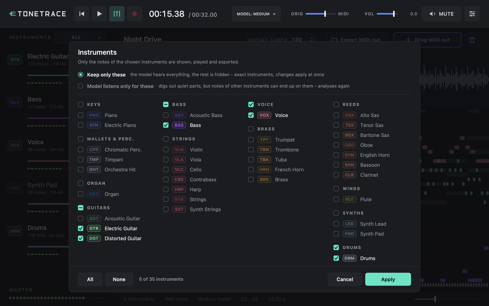

<p align="center"></p>

<p align="center"><a href="https://taiigris.github.io/tonetrance/"><b>Website</b></a> · <a href="https://github.com/taiigris/tonetrance/releases/latest"><b>Download</b></a></p>

**Tonetrace** is a macOS VST3 effect that turns a whole song into MIDI: drop an audio file on it (or record the track), and the MuScriptor model transcribes every instrument - drums included - while you can already play the song and watch the notes appear. Drag the result into your DAW as one MIDI track per instrument. Choose the model size (small, medium, large) and exactly which of its 35 instruments you want. The layout follows NeuralNote. Everything below is in German.

Tonetrace 5.1: Song ins Fenster ziehen oder aufnehmen, alle Instrumente werden erkannt und getrennt, die Noten erscheinen Schritt für Schritt in der Piano Roll, Wiedergabe geht sofort, Export als MIDI mit einer Spur pro Instrument. Modellgröße (Small, Medium, Large) und Instrumente (35 einzeln wählbar) bestimmst du selbst.


## Features

- **Ganzer Song statt Aufnahme**: eine Audiodatei (wav, aiff, mp3, m4a, flac, caf; bis 10 min) ins Fenster ziehen oder **Open song…** – oder wie bisher **●** drücken und die Spur im Host abspielen (bis 2 min).
- **Eine Erkennung**: MuScriptor (Transformer von Kyutai/Mirelo, über muscriptor.cpp lokal auf der GPU) transkribiert den ganzen Mix mit allen Instrumenten **inklusive Drums** (GM-Drum-Noten). Classic- und Neural-Engine, Spektrogramm und Noten-Zeichnen sind entfallen.
- **Schritt für Schritt**: das Modell arbeitet in 5-s-Abschnitten; jeder fertige Abschnitt trägt seine Noten sofort in die Piano Roll ein. Der noch nicht analysierte Teil ist abgedunkelt („Transcribing…“), die Wellenform zeigt ihn gedimmt, die Statuszeile den Fortschritt.
- **Wiedergabe während der Analyse**: Play ist aktiv, sobald die Datei dekodiert ist (wenige Sekunden). Gespielt werden das Original und die Noten (eigener Synth, Drums als kleines GM-Kit), Balance mit **ORIG – MIDI**, Lautstärke **VOL**, **MUTE** stummt das Signal der Spur selbst.
- **Instrumente übersichtlich**: links eine Leiste pro erkanntem Instrument (Farb-Chip, Name, Notenzahl und Tonumfang bzw. „hits · kit map“), **M**/**S**, Fader mit dB-Wert und Pegelanzeige. Jede Instrumentfamilie hat ihre Farbe in der Piano Roll; stumme Instrumente werden gedimmt. Hover über eine Note zeigt Ton und Instrument.
- **Wellenform oben, Piano Roll darunter** (wie NeuralNote): Klick oder Ziehen setzt den Playhead, Cmd+Rad oder Pinch zoomt, Rad scrollt, Option+Rad ändert die Zeilenhöhe, **[|]** folgt dem Playhead, der Zoom-Regler unten rechts zeigt ganz links den ganzen Song.
- **Instrumente auswählen**: Klick auf **ALL ▾** neben „INSTRUMENTS“ öffnet die Auswahl mit allen 35 Instrumenten des Modells, nach Familien geordnet (Keys, Mallets & Perc., Organ, Guitars, Bass, Strings, Voice, Brass, Reeds, Winds, Synths, Drums; ein Klick auf die Familie schaltet sie ganz). Zwei Arten:
  - **Keep only these** (Standard): das Modell hört alles, angezeigt, gespielt und exportiert werden nur die gewählten Instrumente. Exakte Zuordnung, die Änderung wirkt sofort, ohne neue Analyse; „All“ holt alles zurück.
  - **Model listens only for these**: das Modell wird auf die gewählten Instrumente beschränkt (Konditionierung von MuScriptor) und analysiert neu. Holt leise Parts besser heraus, kann aber Noten anderer Instrumente diesen zuschreiben (im Test: nur Bass + Drums → das Gitarrenriff landet im Bass).
  
- **Modell wählen**: Klick auf **MODEL: MEDIUM ▾** in der Kopfzeile: **Small** (209 MB, am schnellsten, gröber), **Medium** (618 MB, empfohlen) oder **Large** (2,7 GB, am genauesten, am langsamsten). Ein geladener Song wird mit dem neuen Modell sofort neu analysiert, die Wiedergabe läuft weiter. Die Wahl gilt für alle Instanzen auf diesem Mac und bleibt gespeichert (`~/Library/Tonetrace/model-size`).
- **MIDI-Export**: **Drag MIDI out** (in die Arrangement-Ansicht ziehen) oder **Export MIDI out** (Datei speichern): SMF Typ 1, eine Spur pro hörbarem Instrument mit Name und Program Change, Drums auf Kanal 10, ab Songanfang, Tempo aus **EXPORT TEMPO** (Standard: Host-Tempo). Mute/Solo bestimmen, was exportiert wird.
- **Modell-Download**: jede Größe wird beim ersten Gebrauch einmalig von Hugging Face nach `~/Library/Tonetrace/models/` geladen (SHA256-geprüft); der Song ist währenddessen schon abspielbar, die Transkription startet von selbst, sobald das Modell da ist. Das Modellmenü zeigt, welche Größen schon auf dem Mac sind. **Die Modellgewichte sind CC BY-NC 4.0 – nur nicht-kommerzielle Nutzung.**
- **Projekt-State**: alle erkannten Noten mit Instrument, Instrumentauswahl, Mixer, Export-Tempo und Songpfad werden gespeichert; der Song wird beim Öffnen des Projekts wieder von der Datei gelesen (die Noten werden nicht neu berechnet). Eine Aufnahme wird mit ihrem Audio gespeichert (mono, 22 kHz).
- Kein JUCE; Fremdcode nur das VST3 SDK (Hülle) und muscriptor.cpp + ggml (MIT; beim Build geladen, Commit fest).

## Systemanforderungen

- macOS 12 oder neuer; die Transkription braucht **Apple Silicon** (auf Intel läuft das Plug-in, meldet aber „needs an Apple Silicon Mac“)
- VST3-fähiger Host: Ableton Live 12, FL Studio (macOS) und andere VST3-Hosts
- einmalig Internet für das Modell (Small 209 MB, Medium 618 MB, Large 2,7 GB) und genug Speicher (Modell plus ca. 200 MB für einen 10-Minuten-Song; Large braucht rund 3 GB Arbeitsspeicher)

## Installation

Aus der ZIP `Tonetrace-5.1.0-macOS.zip` (selbst gebaut legt `./build.sh --release-zip` sie nach `dist/`):

```bash
unzip Tonetrace-5.1.0-macOS.zip && cd Tonetrace-5.1.0
./install.sh
```

`install.sh` kopiert `Tonetrace.vst3` nach `~/Library/Audio/Plug-Ins/VST3`, signiert ad hoc und entfernt die Quarantäne.

**Gatekeeper:** Das Bundle ist nur ad hoc signiert und nicht notarisiert. Falls nötig:

```bash
xattr -dr com.apple.quarantine ~/Library/Audio/Plug-Ins/VST3/Tonetrace.vst3
```

**Deinstallation:** `./uninstall.sh` (entfernt auch eine alte Live-Bridge aus Tonetrace 4; mit `--logs` zusätzlich den Log-Ordner). Die Modelle in `~/Library/Tonetrace/models/`, die Modellwahl in `~/Library/Tonetrace/model-size` und exportierte MIDI-Dateien in `~/Music/Tonetrace` bleiben erhalten (zum Entfernen den Ordner `~/Library/Tonetrace` löschen).

## Einrichtung im Host

**Ableton Live:** Einstellungen > Plug-Ins > „VST3-Plug-In-Systemordner verwenden“ einschalten, neu scannen. Tonetrace auf eine beliebige Spur legen (für eine Aufnahme auf die Spur mit dem Audio). Ohne geladenen Song läuft das Audio unverändert durch.

**FL Studio (macOS):** Options > Manage plugins > Find plugins, Tonetrace in einen Mixer-Slot laden.

## Schnellstart

1. Tonetrace auf eine Spur legen und das Fenster öffnen.
2. Einen Song ins Fenster ziehen (oder **Open song…**). Nach wenigen Sekunden erscheint die Wellenform.
3. **▶** (oder Leertaste) – der Song spielt, während die Noten Abschnitt für Abschnitt erscheinen. Links tauchen die Instrumente auf.
4. Mit **M**/**S** und den Fadern abhören, mit **ORIG – MIDI** zwischen Original und Noten überblenden. Nur bestimmte Instrumente gewünscht? **ALL ▾** neben „INSTRUMENTS“ anklicken und auswählen. Anderes Modell? **MODEL ▾** oben anklicken.
5. **EXPORT TEMPO** auf das Songtempo stellen und **Drag MIDI out** in die Arrangement-Ansicht ziehen: eine MIDI-Spur pro Instrument.

### Tasten

| Taste | Wirkung |
|---|---|
| Leertaste | Play / Pause |
| Return | zum Anfang |
| Cmd+O | Song öffnen |
| Cmd+E | MIDI exportieren (speichern) |
| Cmd+Rad / Pinch | Zeit-Zoom |
| Rad, Shift+Rad | Zeilen bzw. Zeit scrollen |
| Option+Rad | Zeilenhöhe |

## Diagnose und Fehlerbehebung

- **Log:** `~/Library/Logs/Tonetrace/Tonetrace.log` (1 MB x 3 Dateien, nie vom Audio-Thread geschrieben).
- **Diagnosepanel:** Knopf rechts oben oder im About-Overlay „Diagnostics“: Version/Build, Host, Sample-Rate, DSP-Last, Overruns, Modellstatus („Transcription model“), Bildrate, letzter Fehler, **Copy report**, **Save report…**, **Open log folder**.
- **„Transcription unavailable“** in der Statuszeile nennt den Grund (Download fehlgeschlagen, Intel-Mac, Datei beschädigt). Der Song bleibt abspielbar.
- **Plug-in erscheint nicht:** Scan wiederholen, Quarantäne entfernen (siehe Installation).
- **Absturzberichte** liegen in `~/Library/Logs/DiagnosticReports`; `build.sh` bricht ab, wenn ein Lauf neue `tonetrace_*`-Berichte erzeugt.

## Aus dem Quellcode bauen

Voraussetzungen: Xcode (clang, codesign, iconutil) und CMake 3.20+. Das VST3 SDK (MIT, nicht im Repository) wird einmalig geklont:

```bash
mkdir -p external && git clone --depth 1 --branch v3.8.1_build_84 https://github.com/steinbergmedia/vst3sdk.git external/vst3sdk
cd external/vst3sdk
git submodule update --init --depth 1 base pluginterfaces public.sdk cmake
cd ../..
./build.sh
```

| Aufruf | Wirkung |
|---|---|
| `./build.sh` | Build, Unit-Tests, Transkriptionstest (echtes Modell, wenn vorhanden), UI-Test, Benchmark, Installation, Signierung, validator, Hosttest, Screenshots, Absturzbericht-Prüfung |
| `./build.sh --no-install` | Build, Unit-Tests, Transkriptionstest und UI-Test |
| `./build.sh --release-zip` | wie `./build.sh`, danach `dist/Tonetrace-5.1.0-macOS.zip` |

muscriptor.cpp + ggml werden als arm64-Unterbuild geholt (festes Commit) und per `lipo` mit einem x86_64-Stub vereint. Die Version steht nur in `VERSION`.

## Projektstruktur

```
src/vst3/         VST3: Processor, Controller (Parameter, State), Entry/Factory, NSView-Editor
src/core/         Kernel: Dokument (Song, Noten, Transkriptionsstand), Jobs (Laden, Transkription), Audio-Thread (Aufnahme,
                  Wiedergabe Original + Noten), State, Mixer, Instrumente, Song-Import, Diagnose, Log
src/analysis/ml/  MuScriptor: Registry und Notenumwandlung (MuScriptorEngine), Download und Laden (MuScriptorTranscriber.mm),
                  C++23-Brücke (muscriptor/, arm64; Stub für x86_64), Audiodateien über Core Audio (AudioFileDecoder.mm), Resampler
src/preview/      Noten-Synth (Töne + GM-Drum-Kit, Pegel pro Instrument), lock-freie Notentabelle für den Audio-Thread
src/midi/         MIDI-Writer (SMF Typ 1) und Export-Planer (eine Spur pro Instrument)
src/state/        State-Codec v6, Editor-Einstellungen
src/ui/           Cocoa-Oberfläche: Hauptansicht, Instrumentenleisten, Wellenform, Piano Roll, Bedienelemente, About, Diagnose
tests/            Unit-Tests (Fake-Decoder und Fake-Modell mit Abschnitten), Demo-Song für die Werkzeuge
tools/            mstest (echtes Modell), UI-Test, Screenshots, Benchmark, Hosttest, Logo/Icon, Release-Dateien
```

## Performance

Gemessen mit `tonetrace_bench` (Release, nativ), Details in `docs/PERFORMANCE.md`:

- Audio-Thread (48 kHz, 64 Frames): Leerlauf 0,01 %, Aufnahme 0,01 %, Song + Noten aller Instrumente 0,3 % im Mittel, Spitze unter 2 % (Ziel: Mittel < 5 %, Spitze < 25 %). Keine Allokation, keine Locks.
- Speicher: leere Instanz ca. 6 MB, mit einem 10-Minuten-Song ca. 195 MB (plus Modell).
- Transkription (Medium): ca. ein Drittel der Songlänge auf Apple Silicon (5 min Song in ca. 112 s inkl. Laden des Modells), die Noten kommen alle 5 s Audio. 15-s-Testausschnitt inkl. Laden: Small 2,4 s, Medium 5,7 s, Large 19 s.
- Editor: ein ganzes Bild (1280 × 800, 5 Instrumente, Wiedergabe) ca. 4 ms.

## Bekannte Einschränkungen

- Ableton Live und FL Studio wurden bei der Entwicklung nicht gestartet: geprüft sind Hosttest, UI-Test, validator und der Transkriptionstest.
- Das Songtempo wird nicht erkannt: **EXPORT TEMPO** vor dem Export auf das Songtempo stellen (Standard ist das Host-Tempo).
- Die Instrumente sind die 35 Gruppen des Modells (z. B. „Distorted Guitar“, „Synth Pad“); zwei gleiche Instrumente landen in einer Spur. Mit „Model listens only for these“ kann das Modell Noten nicht gewählter Instrumente den gewählten zuschreiben; „Keep only these“ tut das nie. Das Modell sagt keine Anschlagstärke voraus (alle Noten Velocity 100).
- Auf rein synthetischen Klängen (nackter Sägezahn, Sinus) ist das Modell unzuverlässig; auf echten Tracks liefert es auch Pad-Akkorde, die man ggf. stummschaltet.
- Die Noten-Wiedergabe ist ein einfacher Synth zum Abhören, kein Instrument-Sound.
- Ist die Songdatei beim Öffnen des Projekts nicht mehr da, bleiben die Noten, das Original ist stumm (Hinweis im Banner).
- Notenbearbeitung (Zeichnen, Verschieben, Undo) gibt es nicht mehr; Projekte aus Tonetrace 4 werden nicht geladen (Hinweis „saved by Tonetrace 4“).
- Der Editor funktioniert nur, wenn Processor und Controller im selben Prozess laufen (alle gängigen Mac-Hosts).

## Changelog

### 5.1.0 – Modell- und Instrumentauswahl

- **Modellgröße wählbar:** Menü an der Modellanzeige oben: Small (209 MB), Medium (618 MB, Standard) oder Large (2,7 GB), jeweils mit eigenem Download (SHA256-geprüft) und Anzeige, ob die Größe schon auf dem Mac ist. Die Wahl gilt global und bleibt gespeichert; ein geladener Song wird sofort neu analysiert, während er weiterspielt. In schmalen Fenstern wird die Anzeige kürzer („MEDIUM ▾“) statt zu verschwinden.
- **Instrumente einzeln wählbar:** Auswahl mit allen 35 Instrumenten des Modells nach Familien (Familie als Ganzes umschaltbar, All/None, Escape/Return). „Keep only these“ filtert die volle Analyse sofort; „Model listens only for these“ beschränkt das Modell selbst (MuScriptor-Konditionierung) und analysiert neu. Strips, Piano Roll, Wiedergabe und Export zeigen nur die gewählten Instrumente.
- **Neuanalyse:** neue Analyse desselben Songs ohne Neuladen; Aktualisierungen einer abgelösten Analyse werden verworfen.
- **State v7:** Instrumentauswahl, Modus und alle erkannten Noten (die Auswahl lässt sich nach dem Öffnen eines Projekts ändern); v6-Projekte (5.0) laden weiter.
- **Tests:** 9 neue Unit-Tests (Auswahl, Modellgrößen, Filter ohne Neuanalyse, Fokus mit Neuanalyse, verworfene Spät-Updates, State v7/v6), 13 neue UI-Prüfungen, mstest prüft Bass + Drums mit dem echten Modell und lädt optional weitere Größen (Small und Large auf dem 15-s-Testausschnitt: 451 bzw. 466 Noten, Gitarre, Bass, Drums).

### 5.0.0 – Neugestaltung nach NeuralNote

- **Nur noch die funktionierende Erkennung:** MuScriptor ist die einzige Notenerkennung. Classic- und Neural-Engine (Spektrogramm-Analyse, Pitch-Lines, Basic Pitch/CoreML), Notenbearbeitung mit Undo, Snap/Magnet/Tuning, Quick Grab, Live-Bridge und Sampler-Spur sind entfernt.
- **Oberfläche wie NeuralNote:** Transportleiste (Zurück, Play/Pause, Folgen, Aufnahme, Zeit, Modellstatus, ORIG–MIDI, Lautstärke, Mute), Instrumentenleisten mit Chip, Notenzahl, Tonumfang, M/S, Fader und Pegel, Master-Pegel, Songkopf mit Export-Tempo, Export und Drag MIDI out, Wellenform mit Zeitlineal, Piano Roll mit Instrumentfarben, Statuszeile mit Fortschritt und Zoom. Das Spektrogramm in der Mitte ist entfallen.
- **Streaming:** jeder 5-s-Abschnitt des Modells landet sofort im Dokument; der Song ist abspielbar, sobald er dekodiert ist; das Modell wird bei Bedarf geladen und die Transkription startet von selbst nach dem Download.
- **Wiedergabe:** Original (Stereo) und Noten-Synth mit GM-Drum-Kit, Mute/Solo/Fader pro Instrument, sample-genaue Notenstarts, Pegel pro Instrument; ohne Allokation im Audio-Thread (Test mit Allokationszähler, auch während Noten nachkommen).
- **State v6:** Parameter (Record, Mix, Volume, Mute input, Bypass), Mixer, Export-Tempo, Dokument; Song wird von der Datei neu gelesen, Aufnahmen behalten ihr Audio.
- **Speicher:** Dekodieren direkt in 16 Bit, das Modell bekommt ein Mono-16-kHz-Signal ohne Float-Kopie des ganzen Songs (10-Minuten-Song 195 statt 411 MB).
- **Tests:** neue Unit-Tests (Streaming mit gestaffeltem Fake-Modell, Wiedergabe während der Analyse, Mixer, Aufnahme, Abbruch, Warten auf den Modell-Download, State v6, Echtzeit-Sicherheit), neuer UI-Test (47 Prüfungen), mstest lädt den Testausschnitt als Song über Core Audio und prüft Streaming, Wiedergabe und Mehrspur-MIDI mit dem echten Modell.

### 4.7.0 – Ganzer Song, eine MIDI-Spur pro Instrument

- **Song-Import:** **Load Song…** und Drag & Drop einer Audiodatei (Core Audio: wav, aiff, mp3, m4a, flac, caf; bis 10 min) ersetzen die Aufnahme. Der Song wird wie eine Aufnahme analysiert (Spektrum, Linien, Tonart) und danach vollständig von MuScriptor transkribiert; Fortschritt und Cancel über den Grab-Knopf, Undo stellt das vorige Dokument wieder her.
- **Instrumente:** jede Note trägt ihr Instrument (GM-Program bzw. Drums). Farbe pro Instrumentfamilie in der Map, Instrumentname im Hover-Label, Rechtsklick → **Select instrument**. Gleiche Töne zweier Instrumente werden nicht mehr zusammengelegt.
- **MIDI:** sobald Noten ein Instrument tragen, schreibt der Export eine Spur pro Instrument (Name, Program Change, Drums auf Kanal 10, bis 15 Melodiekanäle, darüber geteilt), bei Songs ab Songanfang und als „<Song> Tonetrace <BPM>bpm.mid“. Aufnahmen ohne Instrumente exportieren unverändert eine Spur. Neu: ein Note-off liegt nie hinter dem nächsten Note-on derselben Taste (vorher konnten bei direkt aufeinander folgenden Noten durch Rundung Noten verloren gehen).
- **State v5:** Instrument pro Note und Songname; v4/v3 laden weiter. Wellenform und Audio werden weggelassen, wenn sie zu groß für den State sind (statt das Laden scheitern zu lassen).
- **Tests:** 13 neue Unit-Tests (Instrumente, Mehrspur-MIDI, Kanalvergabe, State v5, Import mit Fake-Decoder und Fake-Modell, Fallback, Abbruch); `tonetrace_mstest` lädt den Testausschnitt jetzt zusätzlich als Song über Core Audio und das echte Modell (Distorted Guitar, Bass, Drums; eine Spur je Instrument).

### 4.6.0 – Engine MuScriptor (optional)

- **Erkennung:** dritte Quick-Grab-Engine **MuScriptor** (muscriptor.cpp, Modell `medium`): alle Instrumente eines Mixes inklusive Drums, Drum-Treffer als 1/16-Noten (nie in den nächsten Treffer derselben Trommel). Der Quick-Grab-Regler wirkt bei MuScriptor nicht (das Modell hat keine Schwelle). Am Referenzfenster 156,83 s: 4 von 8 Zeilen, F2 99 % (Classic 2/8, Neural 3/8); Messung in `docs/RESULT-4.5-erkennung.md`.
- **Modell:** Download (620 MB) beim ersten Auswählen der Engine im Hintergrund, SHA256-geprüft, nach `~/Library/Tonetrace/models/`; Fortschritt im Hinweis-Banner und im Diagnosepanel („MuScriptor engine“). Gewichte CC BY-NC 4.0 (nur nicht-kommerziell), nicht im Plugin enthalten.
- **Build:** muscriptor.cpp + ggml als arm64-Unterbuild (festes Commit), per `lipo` mit einem x86_64-Stub vereint; auf Intel-Macs meldet die Engine „needs Apple Silicon“ und Classic läuft. Neuer Test `tonetrace_mstest` (echtes Modell auf dem Testausschnitt von muscriptor.cpp: Plugin-Weg = direkter Aufruf, schneller als Echtzeit, Stille), übersprungen solange das Modell fehlt.
- **Robustheit:** Die Modellgewichte werden vor dem Abbau der Metal-Geräte von ggml freigegeben (sonst Absturz beim Beenden des Hosts). Editor-State bleibt v5, das Engine-Byte nimmt jetzt 0/1/2 auf.


### 4.5.0 – Engine Neural (optional)

- **Erkennung:** zweite Quick-Grab-Engine **Neural** mit dem Modell Basic Pitch (Spotify, Apache-2.0) über CoreML, im Optionen-Popover umschaltbar (**Engine: Classic / Neural**, Editor-State v5, ältere States laden mit Classic). Eigener Decoder (Hysterese, Onset-Spitzen, Brücken bis 1/8 Note), danach die Tonetrace-Regeln: Mindestlänge 1/16 bei Host-BPM, keine kurzen tiefen Noten auf dem Kick, der Quick-Grab-Regler setzt die Aktivierungsschwelle (0 % = 0,6, 100 % = 0,35).
- **Messung:** Referenz-Track F2 72 % statt 24 %, F1 in einem Stück, False Positives 5 statt 11; Techno-Mixes Note-F1 0,61 bis 0,75 statt 0,44 bis 0,60 und Fragmentierung höchstens 1,04; weißes Rauschen weniger Noten. Die Abnahme für den Standard (6 von 8 Zeilen, Dauer-F1 >= 0,85 in allen Techno-Mixes, alte Mixes >= 4.4.1) ist verfehlt, deshalb bleibt **Classic Standard**. Details in `docs/ACCURACY.md`.
- **Robustheit:** ohne Modell, bei CoreML-Fehlern oder ohne gespeichertes Audio läuft Classic, mit Hinweis-Banner und Eintrag im Log; das Diagnosepanel zeigt den Status der Engine. Das Modell lädt erst beim ersten Neural-Grab im Hintergrund-Thread, der Audio-Thread ist unverändert.
- **Tests:** 126 Unit-Tests (neu: Resampler, Decoder, Fensterung, Tempo- und Kick-Regeln, Rückfall auf Classic, Editor-State v5) und ein Modelltest mit dem echten Modell (`tonetrace_mltest`: F1 gehalten plus F2 mit eigenen Anschlägen, Stille, Echtzeitfaktor 0,015).

### 4.4.1 – Oktavnoten mit eigenen Anschlägen

- **Erkennung:** Ein Kandidat im Oberton-Abstand (Oktave, Quinte darüber usw.) zu einem stärkeren tieferen Ton wird nicht mehr automatisch als Oberton verworfen: setzt er nicht gemeinsam mit diesem ein und aus (Onset und Ende beide innerhalb von 60 ms), bleibt er eine eigene Note (Quick Grab, zweiter Durchlauf mit exakter Oberton-Subtraktion). Im Referenz-Track steigt die F2-Überdeckung von ca. 24 auf 36 %, das Ziel 70 % bleibt verfehlt. Gates, Rauschen und alte Mixes unverändert (F1 weiter >= 4.3 in allen Zeilen). Details in `docs/ACCURACY.md`.
- **Tests:** 115 Unit-Tests (neu: Oktavnote mit eigenen Anschlägen neben gehaltenem Bass).

### 4.4.0 – Halte-Erkennung, Breitformat-Oberfläche

- **Erkennung (Quick Grab):** neue Halte-Erkennung (`src/analysis/SustainGrab.cpp`).
  - *Hysterese* (aus bei T_on − 7,5 dB statt einer Schwelle) und *Median über 116 ms*: Töne flackern nicht mehr um die Schwelle.
  - *Pump-Kompensation*: Täler bis 20 dB beenden keinen Ton, ab 6 dB nur bei neuem Anschlag; Lücken bis 1/8 Note bei Host-BPM werden überbrückt (Sidechain-Dips von 6 bis 12 dB).
  - *Drum-Frames als unbekannt*: der Transienten-Gate und die HPSS-Maske schneiden gehaltene Töne nicht mehr an jedem Schlag ab; die Kick (Beat-Raster, Pulsprüfung) wird erkannt und nicht zur Note.
  - *Bass-Grundton* aus langen Fenstern (0,74 s für C1 bis B1, 0,37 s für C2 bis B2) und Oberton-Auslöschung mit Toleranz.
  - *Geisternoten- und Rausch-Filter*: schwache Stücke neben deutlich stärkeren Noten (Leckage, Unterharmonische) und Stücke ohne Spektralspitze (Rauschen, Hi-Hat-Reste) werden verworfen.
  - *Schwelle relativ zum Oktavband* (global begrenzt), *Mindestlänge* 1/16 Note bei Host-BPM (Fallback 120 ms).
  - Warum: 4.3 verlor gehaltene Bassnoten und zerschnitt Pads im Techno; Zahlen (Fragmentierung, Dauer-F1, alte Mixes, Referenz-Track) in `docs/ACCURACY.md`.
- **Oberfläche:** Breitformat 1280 × 720 (Minimum 1024 × 600), Kopfzeile (Logo, Status Key · BPM · Tuning · Notenzahl, Hilfe, Snap, Ansicht, Optionen, Info), links Klaviatur und große Map über die volle Höhe, rechts eine 200-px-Leiste (Gain, Range, Speed, Quick Grab, Record, Reset, Preview, Drag MIDI hervorgehoben, Save .mid, New Sampler Track, Undo/Redo). Sekundäre Schalter im Optionen-Popover. Standard-Zoom **Fit** (die ganze Aufnahme füllt die Breite), keine Statusleiste. Ruhige Optik: Graupalette und eine Akzentfarbe (Türkis), flache Buttons, 8-px-Raster.
- **State:** unverändert (Format und Parameter-IDs stabil, Projekte aus 4.2 und 4.3 laden); ältere Fenstergrößen unter dem neuen Minimum werden angehoben.
- **Tests:** 114 Unit-Tests (neu: Techno-Mixes, Fragmentierung, Bass-Auflösung, Hysterese, Kick-Puls, Mindestlänge, stabile Parameter-IDs), 12 Python-Tests, UI-Test mit Layout-Prüfung bei 1280 × 720 und 1024 × 600 (keine Überlappung, nichts außerhalb) und Popover.
- **Werkzeuge:** `tools/accuracy.sh` und `tools/accuracy.cpp` (Mixes, Fensterscan und Referenzvergleich).

### 4.3.0 – volles Spektrogramm, freie Noten, Sampler-Spur in Live

- **Ansicht Spectrum (Standard) / Lines:** volles, fein aufgelöstes Spektrogramm (8 Bins pro Halbton, Mehrfachauflösung, Interpolation, Heat-Skala bis Weiß), gekachelt und gecacht; Lines ist die Ansicht aus 4.2. Hide drums und Fundamentals sind in der Spectrum-Ansicht standardmäßig aus und dunkeln nur ab (ca. 30 %).
- **Freie Noten:** Standard-Snap 1/16 (Onset bleibt Option), Magnet standardmäßig aus und nur beim Neuzeichnen aktiv, `Alt` kehrt Snap und Magnet um. Verschieben und Längenänderung sind nie an Linien oder Onsets gebunden. Klick und Ziehen zeichnen immer eine Note; Click-to-grab nur mit dem neuen Schalter **Grab on click** (Standard aus). Notenbalken dünn (5 bis 6 px) und türkis-grün.
- **Erkennung wie v3:** Quick Grab nutzt die v3-Analyse (Salienz und Segmentierung auf dem harmonischen Anteil), Segmente ab 120 ms; die feine Tonhöhe dient nur der Cent-Bestimmung. Messbarer Vergleich mit v3 in `docs/ACCURACY.md` (F1 in jedem Mix mindestens so gut), Werkzeug `tools/compare_v3.sh`.
- **Live-Bridge:** neuer Ordner `live-bridge/TonetraceBridge` (MIDI Remote Script), Knopf **New Sampler Track**, Schalter **Sampler track on Drag**, Statusanzeige **Live bridge**, Datei-Protokoll in `~/Library/Application Support/Tonetrace/bridge`. `build.sh` und `install.sh` installieren die Bridge, `uninstall.sh` entfernt sie.
- **State:** Editor-State v4 (liest v1 bis v3), Projekte aus 4.2 laden unverändert (Spectrum-Ansicht, Onset und Magnet bleiben wie gespeichert).
- **Tests:** 106 Unit-Tests (neu: Standardwerte, freies Zeichnen und Verschieben in energielose Zeilen, 4.2-State, feines Spektrum, 120-ms-Filter, Bridge-Client), 12 Python-Tests für das Remote Script, UI-Test mit freiem Zeichnen und Verschieben in energielose Zeilen.

### 4.2.0 – glühende Note-Map

- Töne sind leuchtende Heat-Streifen: Kern ca. 2 px (weiß-gelb), gaussförmiger Schein bis ca. 8 px und ein dunkelroter/violetter Hauch um starke Linien, additiv überblendet. Farbskala schwarz, dunkelviolett, magenta, rot, orange, gelb, weiß. Die Helligkeit folgt dem Pegel jedes Frames (mit leichter Textur). Schwache Teiltöne und Obertöne (bei *Fundamentals*) sind blasse, dünne violett-blaue Linien. Gain und Range steuern Helligkeit und Kontrast.
- Das Glow-Rendering läuft in den gecachten Kachel-Bitmaps (vorberechnete Gauss-Profile, Colormap-LUT, 4 Subpixel-Phasen); der Audio-Thread ist unverändert.
- Zeilenraster fast schwarz: keine Streifen für schwarze Tasten, nur eine dezente Linie bei C und eine sehr leise zwischen E und F. Zeilen-Hover bleibt, dezenter.
- Klaviatur schmal (14 px Tastenstreifen, C-Labels links davon); die aktive Taste leuchtet türkis. Die Map ist 16 px breiter.
- Noten sind flache grüne Balken (#2FBF5B, 5 bis 7 px, ohne Rahmen), ausgewählte orange (#FF9F43), die Ghost-Note ein halbtransparenter Balken. Der Name erscheint nur bei Hover oder Auswahl neben dem Balken. Hover-Label und Segment-Outline mit dünner heller Linie.
- Waveform-Spur kompakt (44 px) in gedämpftem Türkis; neuer Toggle **Wave** im Optionen-Popover (Standard an, Editor-State v3, liest v1 und v2).
- Tests: 90 Unit-Tests (neu: Colormap-LUT, Glow-Profil, Wave-Toggle-State); Versionsprüfungen der Tools folgen der VERSION-Datei.

### 4.1.0 – präzise Note-Map

- Die Map zeigt dünne, scharfe Peak-Linien auf der exakten Tonhöhe statt ganzer Halbton-Balken (Peak-Map, Mehrfachauflösung, parabolische Interpolation, Peak-Tracking mit ±40 ct und Lücken bis 2 Frames). Die alte Heatmap bleibt als Rückfall für Aufnahmen ohne Linien.
- Neu: Click-to-grab, Ghost-Note, Hover-Label mit Cent-Abweichung, Zeilen-Hervorhebung und Tasten-Leuchten, Segment-Outline, kurzes Aufleuchten der Linie nach dem Anlegen.
- Neu: **Fundamentals** (Obertöne abdunkeln), **Tuning-Erkennung** mit **Align** und manuellem Trim (±50 ct), Snap-Modus **Onset** (Standard) mit eigener Onset-Erkennung (Spectral Flux, 6 ms Raster).
- Magnet und Quick Grab nutzen die Linien statt der Zeilenenergie. Gezeichnete Noten sind schmaler und mittig in der Zeile.
- Piano-Roll-Raster, neue Bedienelemente (Fundamentals, Align, Tuning) mit Tooltips und Statuszeile; Snap-Liste um *Onset* erweitert.
- State: Format unverändert (v4), Editor-State v2 (liest v1), Projekte aus 4.0 laden weiter.
- Tests: 84 Unit-Tests (neu: Tuning ±3 ct, Peak-Genauigkeit ≤ 5 ct, Halbton-Trennung E2/F2 und C5/C#5, Obertöne ≤ 25 %, Vibrato, Click-to-grab ±30 ms, Onset-Snap ±15 ms, Migration), UI-Test mit Hover-Label, Ghost und Click-to-grab.

### 4.0.0

Map & Draw: Live-Spektrogramm, Noten zeichnen, MIDI-Export, Preview, Diagnose (siehe oben).

## Lizenzhinweise

Das VST3 SDK von Steinberg steht unter der MIT-Lizenz und wird beim Bauen aus `external/vst3sdk` eingebunden.
Die Notenerkennung linkt muscriptor.cpp und ggml (MIT) sowie pffft (FFTPACK-Lizenz); die Modellgewichte (Kyutai/Mirelo) stehen unter CC BY-NC 4.0, werden nicht mitgeliefert, sondern beim ersten Gebrauch geladen und dürfen nur nicht-kommerziell genutzt werden. Details in `THIRD_PARTY_LICENSES.md`.
Aufbau und Verhalten der Oberfläche folgen NeuralNote (Damien Ronssin, Apache-2.0); es ist kein Code und kein Asset aus NeuralNote übernommen, Tonetrace implementiert alles selbst.
VST is a registered trademark of Steinberg Media Technologies GmbH.
