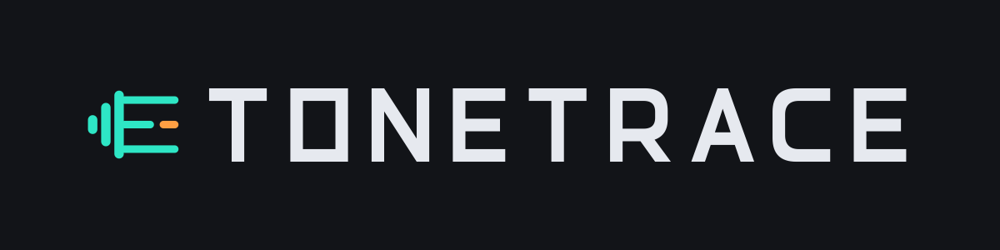
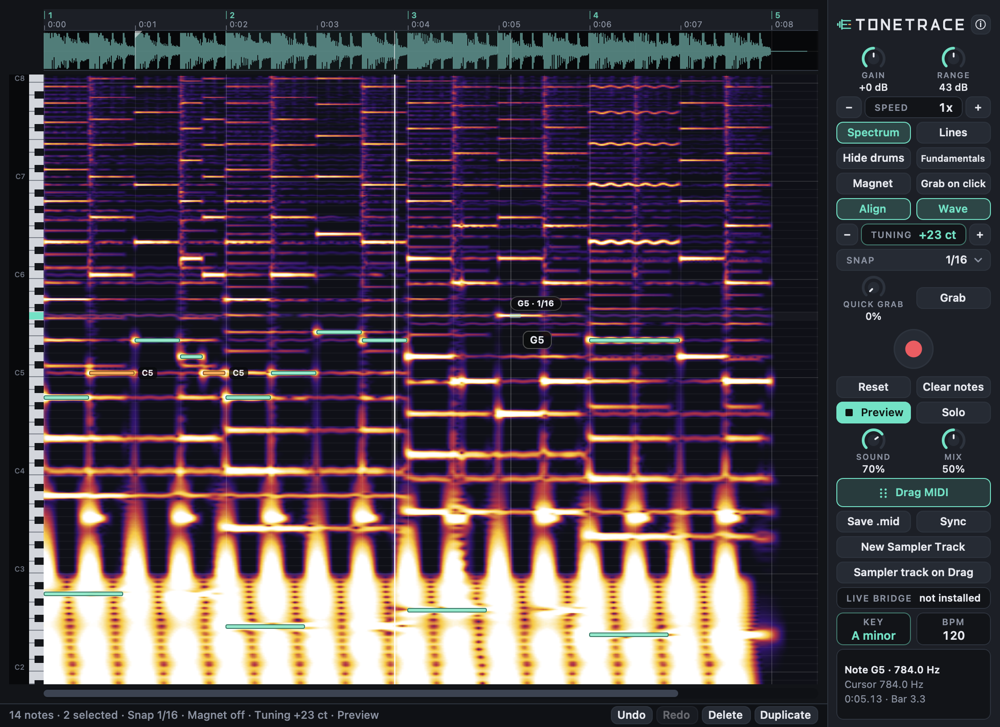

<p align="center"></p>

**Tonetrace** is a macOS VST3 effect: record a sample, see it as a spectrogram note map, draw the notes yourself and drag them out as MIDI. It runs on Apple Silicon and Intel (universal), in Ableton Live 12, FL Studio for Mac and other VST3 hosts. Quick start: install from the ZIP (`./install.sh`), rescan plug-ins, load Tonetrace on the audio track, press Record, play the sample, draw notes, drag MIDI into a MIDI track. Everything below is in German.

Tonetrace 4.0.0: ein Sample aufnehmen, als Spektrogramm sehen, die Noten selbst zeichnen und als MIDI in eine Spur ziehen.



## Features

- **Live-Spektrogramm** als Note-Map mit Waveform und Klaviatur, wächst während der Aufnahme mit (bis 120 s).
- **Noten selbst zeichnen** per Klick-Ziehen, mit Snap (1/4 bis 1/32) und Magnet (rastet auf die hellste Linie ein).
- **Bearbeiten**: verschieben, Länge ändern, Lasso, duplizieren, löschen, Undo/Redo (mindestens 50 Schritte).
- **Hide drums**: zeigt nur den harmonischen Anteil, auch live während der Aufnahme.
- **Quick Grab** (optional): Startpunkt aus den stärksten Linien, danach normal editierbar.
- **Preview** mit eigenem Synth (16 Stimmen), Loop-Bereich, Sound/Mix/Solo und Sync zum Host-Transport.
- **MIDI-Export** per Drag & Drop oder **Save .mid** (SMF Typ 1, 960 PPQ, Aufnahme-Tempo).
- Sichtbare Knöpfe und Kontextmenü für Undo, Redo, Delete, Duplicate (Hosts fangen manche Tasten ab).
- **About-Overlay** (Klick auf das Logo) und **Diagnosepanel** mit Version, Host, DSP-Last, Log-Ordner und Berichtsfunktion.
- State speichert Spektrogramm, Noten und Parameter, Projekte aus Version 3 laden weiter.
- Kein JUCE und kein Fremdcode außer dem VST3 SDK (nur die VST3-Hülle nutzt es).

## Systemanforderungen

- macOS 12 oder neuer, Apple Silicon und Intel (universal)
- VST3-fähiger Host: Ableton Live 12, FL Studio (macOS) und andere VST3-Hosts

## Installation

Aus der ZIP [`releases/Tonetrace-4.0.0-macOS.zip`](releases/Tonetrace-4.0.0-macOS.zip) (SHA-256 in [`releases/SHA256SUMS.txt`](releases/SHA256SUMS.txt)):

```bash
unzip Tonetrace-4.0.0-macOS.zip && cd Tonetrace-4.0.0
./install.sh
```

`install.sh` kopiert `Tonetrace.vst3` nach `~/Library/Audio/Plug-Ins/VST3`, signiert ad hoc und entfernt die Quarantäne.
Manuell: `Tonetrace.vst3` selbst nach `~/Library/Audio/Plug-Ins/VST3` kopieren.

**Gatekeeper:** Das Bundle ist nur ad hoc signiert und nicht notarisiert. Rechtsklick > Öffnen hilft bei Plug-ins nicht.
Stattdessen die Quarantäne-Markierung entfernen:

```bash
xattr -dr com.apple.quarantine ~/Library/Audio/Plug-Ins/VST3/Tonetrace.vst3
```

**Deinstallation:** `./uninstall.sh` (mit `--logs` auch den Log-Ordner), oder `~/Library/Audio/Plug-Ins/VST3/Tonetrace.vst3` löschen.
Exportierte MIDI-Dateien in `~/Music/Tonetrace` bleiben erhalten.

## Einrichtung im Host

**Ableton Live:** Einstellungen > Plug-Ins > „VST3-Plug-In-Systemordner verwenden“ einschalten, neu scannen (Option-Taste beim
Klick erzwingt einen vollständigen Scan). Tonetrace erscheint unter Plug-Ins > VST3 und kommt auf die Audiospur mit dem Sample.
Das Audio läuft unverändert durch.

**FL Studio (macOS):** Options > Manage plugins > Find plugins (der Ordner `~/Library/Audio/Plug-Ins/VST3` wird durchsucht),
Tonetrace aktivieren und in einen Mixer-Slot laden, auf dem das Sample liegt.

## Schnellstart

1. Tonetrace als Effekt auf die Spur mit dem Sample legen.
2. **Record** (roter Knopf) drücken und das Sample im Host abspielen. Nochmal drücken beendet die Aufnahme.
3. Helle Linien sind Töne. Mit **Gain** und **Range** die Anzeige anpassen.
4. Noten per Klick-Ziehen auf die hellen Linien zeichnen.
5. **Drag MIDI** in eine MIDI-Spur ziehen (oder **Save .mid**).

## Bedienung im Detail

- **Zeichnen:** Klick-Ziehen auf leerer Fläche, die Note entsteht in der Zeile unter dem Cursor. **Snap** rastet Anfang und Ende
  nach Host-BPM ein (`Alt` = ohne Snap), **Magnet** zieht die Tonhöhe auf die hellste Zeile innerhalb von ±1 Halbton.
- **Bearbeiten:** Mitte ziehen verschiebt (alle gewählten Noten gemeinsam), die Ränder (6 px) ändern die Länge, Doppelklick löscht,
  Rechtsklick öffnet das Menü. Klick wählt, `Shift`-Klick schaltet um, `Cmd`-Ziehen zieht ein Lasso.
- **Quick Grab:** Regler (0 bis 100 %) und **Grab** erzeugen Noten aus den stärksten Linien. Ohne Klick passiert nichts.
- **Preview** (Leertaste) spielt Aufnahme und Noten ab der Startmarke im Loop. Im Waveform-Streifen setzt ein Klick den Start,
  Ziehen einen Loop-Bereich. **Sound** = Synth-Lautstärke, **Mix** = Balance Sample/Noten, **Solo** = Eingang stumm,
  **Sync** = Preview folgt dem Host-Transport.
- **MIDI:** Exportiert werden die gewählten Noten, sonst alle. Dateiname `Tonetrace <Tonart> <BPM>bpm.mid` in `~/Music/Tonetrace`,
  Velocity fest 100.
- **Reset** löscht Aufnahme und Noten (mit Rückfrage und Undo), **Clear notes** nur die Noten. **Key** und **BPM** zeigen
  Tonart und Aufnahme-Tempo. Oktaven nach wissenschaftlicher Notation (MIDI 69 = A4 = 440 Hz).

### Shortcuts

| Aktion | Eingabe |
|---|---|
| Note zeichnen | Klick-Ziehen auf leerer Fläche |
| ohne Snap zeichnen / verschieben | `Alt` gedrückt halten |
| Note verschieben | Ziehen in der Mitte |
| Länge ändern | Ziehen am linken/rechten Rand |
| Note löschen | Doppelklick, Menü, Knopf Delete, `Backspace` / `Entf` |
| auswählen | Klick; `Shift`-Klick mehrfach; `Cmd`-Ziehen Lasso; `Esc` nichts wählen |
| alles wählen / duplizieren | `Cmd+A` / `Cmd+D` |
| Undo / Redo | `Cmd+Z` / `Cmd+Shift+Z` |
| Preview an/aus | `Leertaste` (Map fokussiert) |
| vertikal / horizontal scrollen | Mausrad / `Shift`+Mausrad, Trackpad, Scrollbalken |
| Zeitzoom (0,25x bis 8x) | `Cmd`+Mausrad, Pinch, `−`/`+` im Panel |
| vertikaler Zoom | `Alt`+Mausrad |
| Ton vorhören | Klick auf die Klaviertaste |
| About-Overlay | Klick auf das Logo, schließen mit `Esc`, ✕ oder Klick daneben |
| Kontextmenü | Rechtsklick (oder Ctrl-Klick) |

**Hinweis zu Hosts:** Live fängt manche Tasten ab (Cmd+Z, Leertaste, Backspace). Dafür gibt es die Knöpfe Undo, Redo, Delete,
Duplicate in der Statusleiste und das Kontextmenü per Rechtsklick auf Note oder Map.

## Diagnose und Fehlerbehebung

- **Log:** `~/Library/Logs/Tonetrace/Tonetrace.log` (1 MB x 3 Dateien, geschrieben vom Hintergrund-Thread, nie vom Audio-Thread).
- **Diagnosepanel:** Knopf ⓘ im Panel oder im About-Overlay „Diagnostics“. Es zeigt Version/Build, Host, Sample-Rate, Blockgröße,
  DSP-Last, Overruns, Worker-Verzögerung, Aufnahmespeicher, Bildrate und den letzten Fehler. **Copy report**, **Save report…**
  und **Open log folder** helfen beim Melden von Problemen.
- **Live-Log:** `tools/check_live_log.sh` zeigt alle Tonetrace-Zeilen der neuesten Live-12-`Log.txt` plus Warnungen.
- **Plug-in erscheint nicht:** Scan wiederholen, prüfen ob `~/Library/Audio/Plug-Ins/VST3/Tonetrace.vst3` existiert, ggf. Quarantäne entfernen (siehe Installation).
- **Absturzberichte** liegen in `~/Library/Logs/DiagnosticReports`. `build.sh` bricht ab, wenn ein Lauf neue `tonetrace_*`-Berichte erzeugt.

## Aus dem Quellcode bauen

Voraussetzungen: Xcode (clang, codesign, iconutil) und CMake 3.20+. Das VST3 SDK (MIT, nicht im Repository) wird einmalig geklont:

```bash
mkdir -p external && git clone --depth 1 --branch v3.8.1_build_84 https://github.com/steinbergmedia/vst3sdk.git external/vst3sdk
cd external/vst3sdk
git submodule update --init --depth 1 base pluginterfaces public.sdk cmake
cd ../..
./build.sh
```

| Aufruf | Wirkung |
|---|---|
| `./build.sh` | Build, Unit-Tests, UI-Test, Benchmark, Installation, Signierung, validator, Hosttest, Screenshots, Absturzbericht-Prüfung |
| `./build.sh --no-install` | nur bauen, Unit-Tests und UI-Test |
| `./build.sh --release-zip` | wie `./build.sh`, danach `dist/Tonetrace-4.0.0-macOS.zip` |
| `tools/make_icon.sh` | rendert Logo-PNGs, `docs/logo.png` und `assets/logo/Tonetrace.icns` neu (sind eingecheckt) |

Die Version steht nur in `VERSION`, der Build-Hash (git) im About-Overlay und im Diagnosepanel.

## Projektstruktur

```
src/vst3/      VST3: Processor, Controller (Parameter, State), Entry/Factory, NSView-Editor
src/core/      Kernel (plattformneutral): Capture, Preview, Analyse-Thread, Notenmodell, Snapshot, Diagnose, Log
src/analysis/  Live-Spektrum, Waveform-Peaks, HPSS/Drum-Filter, Noten-Analyse, Quick Grab, Tonart, FFT
src/capture/   vorab allokierter Aufnahmepuffer (120 s)
src/midi/      MIDI-Writer (SMF Typ 1) und Export-Planer
src/preview/   Preview-Synth, lock-freie Notenübergabe
src/state/     State-Codec (v4, liest v3), Editor-Einstellungen
src/ui/        Cocoa-Oberfläche (TTR*_v1): Map, Waveform, Piano, Controls, Logo (TTRLogo), About-Overlay, Diagnose
assets/logo/   Logo als SVG, gerenderte PNGs (png/) und Tonetrace.icns
tests/         Unit-Tests ohne Fremdbibliotheken
tools/         Hosttest, UI-Test, Benchmark, Screenshot-Tool, Logo-Renderer, check_live_log.sh, Release-Dateien
docs/          Screenshots, Logo, PERFORMANCE.md
```

## Performance

Gemessen mit `tonetrace_bench` (Release, universal, nativ), Details in `docs/PERFORMANCE.md`:

- Audio-Thread (48 kHz, 64 Frames): Idle 0,003 % Mittel, Record 0,007 %, Preview mit 16 Stimmen und Limiter 0,45 % Mittel, Spitze unter 2 % (Ziel unter 10 %). Keine Allokation, keine Locks.
- Speicher pro Instanz: leer wenige MB, 120 s Aufnahme bei 44,1 kHz ca. 38 MB (nach der Analyse ca. 91 MB), bei 192 kHz ca. 109 MB. Der Puffer wird erst beim Aufnehmen belegt.
- Analyse: live in Echtzeitfaktor 0,002, Endanalyse von 60 s Audio in 0,2 s, Quick Grab in 0,01 s.

## Bekannte Einschränkungen

- Ableton Live und FL Studio wurden bei der Entwicklung nicht gestartet: geprüft sind Hosttest, UI-Test und Validator.
- Der Editor funktioniert nur, wenn Processor und Controller im selben Prozess laufen (alle gängigen Mac-Hosts).
- Die Live-Trennung bei Hide drums kennt nur die Vergangenheit und weicht leicht vom Ergebnis nach dem Stoppen ab.
- Bass unter ca. E2 (82 Hz) ist wegen der Fensterlänge nur grob aufgelöst.

## Lizenzhinweise

Das VST3 SDK von Steinberg steht unter der MIT-Lizenz und wird beim Bauen aus `external/vst3sdk` eingebunden.
VST is a registered trademark of Steinberg Media Technologies GmbH.
